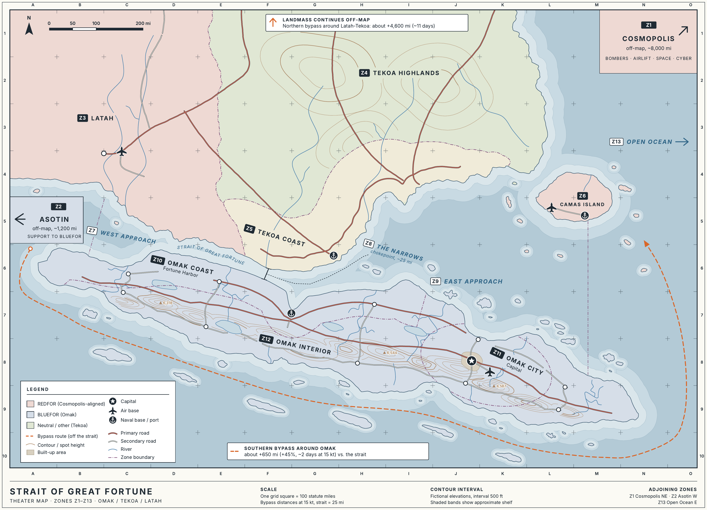

**Audience:** every player, REDFOR and BLUEFOR. Everything here is public in the game world. Your team's own documents add what only your side knows.

*All countries, people, and events in this scenario are fictional. All military systems are real U.S. systems, described with unclassified, approximate capabilities.*

## 1. Bottom line up front

- **REDFOR = Cosmopolis**, a distant, rich, powerful, technologically advanced nation that calls itself a democracy with an apolitical military (the Cosmopolis National Defense Forces, **CNDF**). It is about **8,000 miles northeast** of the conflict.
- **BLUEFOR = Omak.** An election scandal (revealed Cosmopolis backing of the Sapphire Party president) and wider discontent triggered an uprising. The apolitical **National Democratic Forces (NDF)** stood aside and let the **People's Freedom Alliance (PFA)**, the armed wing of the **Indigo Party**, take power.
- The **Strait of Great Fortune**, a major trade chokepoint **25–75 miles wide**, is bounded by **Omak to the south** and **Tekoa to the north**.
- Cosmopolis had trade deals and a defense treaty with the ousted Sapphire president, who **fled to Cosmopolis**.
- **Asotin**, a peer adversary of Cosmopolis, **backs the PFA government in Omak**.
- **Balance.** REDFOR starts with **more assets**. BLUEFOR has **natural advantages**: it is defending its own land, it has a **supportive population**, and it can **receive support from Asotin**.
- **All assets are American.** Every asset in the game is a real U.S. military system, mostly **Department of the Air Force**. In-world, Omak's NDF bought its U.S.-type equipment from Cosmopolis under the old treaty. For Asotin it is simply a game convention.

## 2. Background and timeline

Game dates are relative: **D-Day** is the day the war begins.

| When | Event |
| --- | --- |
| ~D−10 years | Cosmopolis and Omak (then governed by the Sapphire Party) sign a **trade agreement** and a **mutual defense treaty**. Cosmopolis gains preferential port access on the Strait and equips Omak's NDF with Cosmopolis-made (U.S.-type) systems. |
| D−6 months | Omak presidential election. The Sapphire incumbent narrowly wins. |
| D−4 months | Leaked documents show **Cosmopolis covertly funded and advised the Sapphire campaign**. Protests spread, fueled by existing anger over inflation, unemployment, and corruption. |
| D−3 months | The PFA seizes government buildings in the capital, **Omak City**. The **NDF's leadership declares neutrality** and does not resist. The Sapphire president **flees to Cosmopolis**. |
| D−2 months | The PFA-backed Indigo government is sworn in. Cosmopolis refuses to recognize it and calls the takeover a coup. **Asotin recognizes the new government** and offers support. |
| D−3 weeks | The Indigo government announces it will "review" all Sapphire-era agreements, including Cosmopolis's port access and the defense treaty. Asotin cargo flights begin arriving in Omak. Cosmopolis reinforces its forward air base on **Camas**. |
| D−3 days (**Phase I**) | Crisis peak. Cosmopolis demands guarantees of free passage. The PFA moves patrol boats and missile batteries to the Strait coast. Both sides posture. **Phase I play happens here.** |
| **D-Day** | The white cell's kickoff inject. |

<!-- pagebreak -->

## 3. Map

{width=100%}

Counters go in **zones**. There is no hex grid. The Strait of Great Fortune is **25–75 miles wide**. Its four sea zones (Z7, Z8, Z9, Z13) are parts of the Strait, from west to east.

| Zone | Name | Notes |
| --- | --- | --- |
| Z1 | Cosmopolis (off-map box) | REDFOR home: bombers, airlift, space, cyber, reserves |
| Z2 | Asotin (off-map box) | Omak's backer, white-cell controlled. The source of outside support for BLUEFOR. |
| Z3 | Latah | Pro-Cosmopolis. Air bases. **Combat basing not yet granted.** |
| Z4 | Tekoa Highlands | Mountains. Good radar and SOF terrain. Tribes and gangs. |
| Z5 | Tekoa Coast | North shore of the Strait. Pirate havens. |
| Z6 | Camas Island | Pro-Cosmopolis. **CNDF forward air base.** |
| Z7 | West Approach | The western Strait, toward Latah. Asotin supplies reach Omak this way. |
| Z8 | The Narrows | The middle of the Strait and its **narrowest point (~25 mi)**. The chokepoint. |
| Z9 | East Approach | The eastern Strait, toward Camas |
| Z10 | Omak Coast | Fortune Harbor (major port). Coastal missile sites. |
| Z11 | Omak City (Capital) | Seat of government, main NDF air base, Patriot umbrella |
| Z12 | Omak Interior | Reserve bases, dispersal areas |
| Z13 | Open Ocean (map edge) | Naval approach routes beyond the Strait |

### Key distances

| From → To | Distance | Why it matters |
| --- | --- | --- |
| Strait length (West to East Approach) | ~750 mi | |
| Strait width | **25–75 mi** | Narrow enough that weapons on either shore reach most of it |
| The Narrows, width | ~25 mi (the narrowest point) | Inside Omak's coastal anti-ship missile range. Mineable. |
| Camas → The Narrows | ~620 mi | Fighters need tanker support for persistence. |
| Omak Coast → Camas | ~270 mi (~440 km) | Close enough that Camas would be exposed to any long-range missiles Omak has |
| Latah → The Narrows | ~400 mi | An alternate or dispersal base (ACE) if Latah agrees |
| Omak City (Capital) → Omak Coast | ~140 mi | |
| Omak City (Capital) → Fortune Harbor | ~400 mi | |
| Southern route around the Strait | +650 mi (~2 days at 15 kt) | Ships can avoid the Strait, at a cost in time and fuel |
| Asotin → Omak | ~1,200 mi | Close enough to supply Omak by sea and air |
| Cosmopolis → theater | ~8,000 mi | Long reinforcement timelines (§7) |

<!-- pagebreak -->

## 4. Actors

### 4.1 Cosmopolis — REDFOR (player team)

| Dimension | Situation |
| --- | --- |
| **Political** | Claims to be democratic, with an apolitical military. Hosts the exiled Sapphire president. The exposure of the election meddling is a domestic and international embarrassment, and its legislature is divided over war. Cosmopolis recognizes the exiled president as Omak's legitimate leader and frames intervention as honoring the defense treaty. |
| **Military** | Extremely large, well-armed, and advanced. It projects power 8,000 miles from home, relying on the Camas forward base, airlift, tankers, space, and long-range bombers. It knows Omak's equipment well because it sold most of it. |
| **Economic** | Wealthy, with trade deals with the Sapphire government. A major share of its regional trade moves through the Strait, so closure means price spikes at home. |
| **Social** | Populous. The public is weary of distant wars. Casualties and civilian-harm stories erode support fast. |
| **Information** | Has a global media reach, but its credibility is damaged by the meddling scandal. |
| **Infrastructure** | Camas Air Base: one large, well-equipped base with limited hardening. Rights in Latah cover logistics only. |

### 4.2 Omak — BLUEFOR (player team: one team, a house divided)

| Dimension | Situation |
| --- | --- |
| **Political** | The Indigo Party governs, with its armed wing, the PFA, holding power. The Sapphire Party is ousted, and its leader is in Cosmopolis. Asotin backs the new government. Cosmopolis and its allies contest the government's legitimacy, but it is popular at home after the meddling revelations. |
| **Military** | The NDF is the professional, apolitical military that allowed the takeover. The PFA is a partisan militia. The NDF fields U.S.-type equipment bought from Cosmopolis, so spare parts are a long-term worry that Asotin is helping to cover. NDF and PFA have separate chains of command and mutual distrust. A small minority of NDF officers quietly remain Sapphire loyalists. |
| **Economic** | A major trade hub on the Strait. Port fees and Fortune Harbor are the state's main income, so a long closure hurts Omak too. Asotin credit lines soften the blow. |
| **Social** | Dissatisfaction with the old government drove the uprising, and **the population supports the defense of the country**. Nationalist feeling runs high against foreign interference. Civilians volunteer as militia, lookouts, and laborers. |
| **Information** | The PFA controls state media, and the meddling leak is its best propaganda weapon. |
| **Infrastructure** | Fortune Harbor port, the main air base near Omak City (the capital), a coastal road network, an early-warning radar chain, and dispersal sites in the interior. |

**BLUEFOR factions.** The one BLUEFOR team plays all three. They shape its internal decision-making.

| Faction | Wants | Notes |
| --- | --- | --- |
| Indigo Party (government) | To survive, gain legitimacy, and renegotiate the Strait on Omak's terms | The political masters |
| PFA (Indigo armed wing) | To defend the revolution and destroy Sapphire influence | Militia, maritime militia, info and cyber |
| NDF (apolitical military) | To defend Omak's sovereignty without becoming a party tool | Fields the heavy equipment. Has red lines (§8). |
| Sapphire Party (ousted) | A comeback | **Not BLUEFOR.** Its loyalists are a small, white-cell-controlled fifth column that REDFOR may try to exploit. |

### 4.3 Other actors (controlled by the white cell)

| Actor | Alignment and capability | Interests and levers |
| --- | --- | --- |
| **Asotin** | Peer adversary of Cosmopolis. **Backs the Omak government.** Similar in size, power, and capability to Cosmopolis, ~1,200 mi W of Omak. | Wants a friendly Omak and a Strait that Cosmopolis doesn't control. Supplies arms, intel, and money. Avoids direct war with Cosmopolis unless provoked. |
| **Tekoa** | Neutral. Sparsely populated, mountainous, minimal government, heavily decentralized. Pirates, gangs, and local tribes. | Controls the north shore of the Strait and its airspace. Wants money, aid, and to keep the war off its soil. Can grant or deny overflight and mountain radar sites. |
| **Latah** | Sides with Cosmopolis. Modest military, good air bases. | Has granted logistics access but **not combat basing**. Worried about Omak retaliation and Asotin's reaction. |
| **Camas** | Sides with Cosmopolis. An island state with little military of its own. Hosts the CNDF forward air base. | Its population is nervous about being a target. Civilian casualties on Camas are a political flashpoint. |
| **Pirates, gangs, tribes** | None. Small boats, local knowledge. | Prey on shipping when the Strait is chaotic. Can be hired by anyone. |
| **Shipping and markets** | — | React to Strait Traffic: insurance rates, rerouting, price spikes |
| **The press** | — | The white cell's voice for consequences |

**How to use white-cell actors:** you can argue a COA that tries to persuade, pay, or pressure them ("A diplomatic delegation persuades Latah to grant basing because…"). The white cell adjudicates it like any other COA.

<!-- pagebreak -->

## 5. Tracks

The white cell keeps the tracks on its screen, where both teams can see them. COA results and their consequences move them.

| Track | Range | Starts at | Moves when… | Trigger effects |
| --- | --- | --- | --- | --- |
| **Strait Traffic** | Open / Restricted / Closed | **Open** before the war, **Restricted** once it starts | Mining, blockades, escorts, clearing, deals | **Closed:** −1 to Cosmopolis Domestic Will at the end of each turn it stays Closed |
| **International Opinion** | −3 (pro-Omak) … +3 (pro-Cosmopolis) | **−1** (meddling scandal) | Civilian harm, legitimacy actions, diplomacy, propaganda, broken deals | **+3:** Latah grants full combat basing automatically. **−3:** Asotin escalates its support. |
| **Cosmopolis Domestic Will** | 0 … 5 | **3** | Casualties, a Closed Strait, victories, information ops aimed at Cosmopolis | **≥ 4:** big REDFOR RFFs approved more readily. **0:** the legislature orders a ceasefire and negotiations. |
| **Omak Regime Stability** | 0 … 5 | **4** (supportive population) | Strikes on infrastructure, Sapphire unrest, rallying around the flag, NDF–PFA friction | **5:** S-B1 removed ("national unity"). **0:** the government collapses and the NDF takes over as caretaker. |

## 6. Starting conditions

These are public. Both teams see them on cue cards. Use them in your Pros and Cons.

### REDFOR: more assets, longer reach, more constraints

| ID | Name | Effect | How to remove it |
| --- | --- | --- | --- |
| S-R1 | **The 8,000-Mile Tail** | Reinforcements arrive slowly (§7). Camas can sustain high-tempo operations for **3 turns**. After that, −1 on Camas-based strike COAs until resupplied. | A successful resupply COA, or an RFF for a sustainment package |
| S-R2 | **Single Hub** | All forward forces sit on Camas. A successful BLUEFOR strike on Camas affects **every** counter there, so one roll can Degrade several. | ACE dispersal: a **big project, 2 successful COAs** (e.g. Latah basing + an ACE package) |
| S-R3 | **Latah Hesitates** | Latah allows logistics only. No combat sorties from Latah. | A successful diplomatic COA, or International Opinion reaches +3 |
| S-R4 | **Legitimacy Deficit** | International Opinion starts at −1. COAs that rely on third-party cooperation get −1 while Opinion ≤ −1. | Raise International Opinion to 0 or more |

### BLUEFOR: fewer assets, natural defender's advantages

| ID | Name | Effect | How to remove it |
| --- | --- | --- | --- |
| S-B1 | **A House Divided** | −1 on COAs that need NDF **and** PFA forces to work together | A successful "unified command" COA (it takes this −1 itself, and the removal starts next turn), or Regime Stability reaches 5 |
| S-B2 | **Sapphire Loyalists** | A small minority. REDFOR may argue for defections or sabotage, but such COAs take **−1** because of S-B5. | A successful counterintelligence COA removes the option entirely |
| S-B3 | **Home Ground** *(advantage)* | **+1** to BLUEFOR **defensive** COAs in Omak zones (Z10–Z12): defending, dispersing, hiding, repairing, ambushing, counterintelligence. Defenders know the terrain, and any ground incursion is very costly. | Permanent |
| S-B4 | **Asotin's Backing** *(advantage)* | BLUEFOR requests for Asotin arms and intel are **routinely approved**. Bigger escalations need conditions. Supplies arrive via the West Approach and by air. REDFOR must argue a successful COA to interdict them, and interdiction risks Asotin escalation. | Permanent |
| S-B5 | **Supportive Population** *(advantage)* | Regime Stability starts at 4. REDFOR COAs that rely on Omak civilians (SOF operating in Omak, loyalist uprisings, information ops aimed at Omak's public) take **−1**. BLUEFOR RFIs about REDFOR activity *inside Omak* get full answers (local lookouts). | Eroded: if Regime Stability falls to 2 or lower, the −1 no longer applies |

## 7. Timing and movement

Each turn is about **3 days**. "N" is the turn an RFF is approved.

| Movement | Takes |
| --- | --- |
| Any aircraft within theater (Camas ↔ Strait, Latah ↔ Strait) | Same turn (part of the COA) |
| Fighters, tankers, and ISR self-deploying from Cosmopolis | Arrive N+1 |
| Bombers striking from Cosmopolis | Same turn, but the bomber counter is used up for that turn |
| Airlifted light ground forces | N+2 |
| Naval forces from regional waters | N+2 |
| Amphibious forces | N+3 |
| Heavy ground forces by sea from Cosmopolis | **Beyond the game** (≥ 5 turns) |
| BLUEFOR ground forces within Omak (zone to adjacent zone) | Same turn |
| BLUEFOR mobilization | N+1 |
| Asotin support | N+1 to N+3, depending on what is sent |
| Diplomatic results (basing agreements, recognition) | Same turn if the COA succeeds. Effects begin next turn. |

## 8. Rules of engagement and national directives

These are public in the game world. The white cell may add, change, or lift directives during the game.

### Cosmopolis (REDFOR)

1. No nuclear, chemical, or biological weapons (applies to every actor).
2. **No strikes on leadership or government targets in Omak City (Omak's capital)** without national authority (an RFF for authorities).
3. **No ground forces on Omak soil** without national approval.
4. **Respect Tekoan sovereignty:** no operations in Tekoan territory or airspace without Tekoa's consent.
5. **Do not engage Asotin forces or Asotin-flagged shipments** without national authority. Shipments that have already been delivered inside Omak are fair game.
6. Minimize civilian harm. A COA result causing significant civilian casualties moves International Opinion −1 **and** Domestic Will −1.

### Omak (BLUEFOR)

1. The NDF chief's standing order: **the NDF will not fire on Omak civilians or take part in political repression.** Internal security is PFA-only.
2. Striking *civilian* targets on Camas or in Latah moves International Opinion **+1 (toward Cosmopolis)**, which hurts Omak. Striking **Latah** at all brings Latah into the war.
3. Attacking neutral shipping in the Strait (not Cosmopolis-flagged or military) moves International Opinion +1 (toward Cosmopolis).
